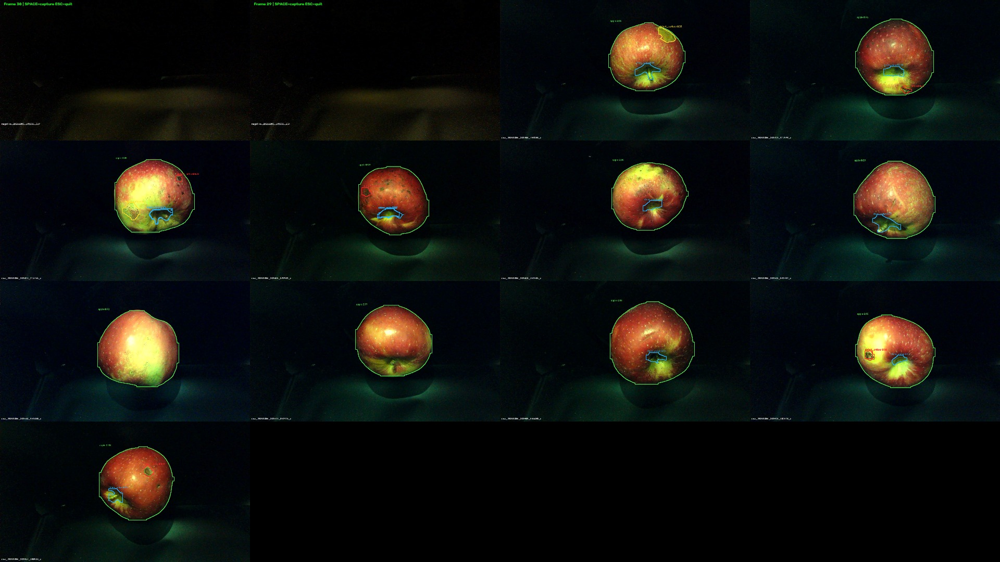

# Preserved AQRE research evidence

See [the retirement decision](../../docs/RETIREMENT.md). Evidence is retained to make both the engineering and the limitations inspectable.

- `predictions.json`: 127 historical hosted prediction records, including polygon coordinates, split metadata and annotation class counts. Remote image URLs were removed; prediction coordinates are preserved. Class counts are not complete ground-truth masks.
- `class_optimal/` and `global_035/`: original October smoke outputs. `class_optimal` means Roboflow evaluation-derived thresholds, not validated deployment recommendations. These were generated under policy 3.0.0 before the zero-defect review flag; do not describe them as current 3.1.0 outputs.
- `test_predictions.jpg`: historical 13-image test split visualization. The split leaked physical apple identity.
- `dataset_manifest.json`: 120 source-image hashes, sizes, profile IDs, view indexes and capture-grade labels.
- `dataset_archive.sha256`: digest of the release ZIP.
- `verification.txt`: checks executed during retirement closeout.

## Partial dataset download

[Download the 120-image partial dataset](https://github.com/davidnichols-ops/apple-quality-recognition-engine/releases/download/research-retirement-2026-11-16/aqre-partial-dataset-2026-11-16.zip).

Thirty distinct apples, four equatorial views each, captured in October 2026. All bear CIDER capture metadata, which is not independent certification. Historical timing, glare and lighting limit interpretation. No reviewed polygon export or model weights are bundled. No additional dataset license is granted; the repository code license should not be assumed to establish image reuse rights.

Verify the archive with `shasum -a 256 -c dataset_archive.sha256`, then check extracted images against `dataset_manifest.json`. Keep all views of a physical apple together if constructing new partitions.

## Replay saved predictions without a model or API

From the repository root, with the declared Python dependencies installed:

```bash
python scripts/smoke_roboflow_predictions.py research/closeout/predictions.json \
  --output-dir dataset/smoke_tests/retirement_replay
```

This runs the current candidate policy (3.1.0) against saved model output. Grades reproduce the historical per-class run; zero-defect review flags differ intentionally. For an exact historical-policy replay, retrieve `grading_policy.yaml` from commit `8033397` and pass it using `--policy`.


